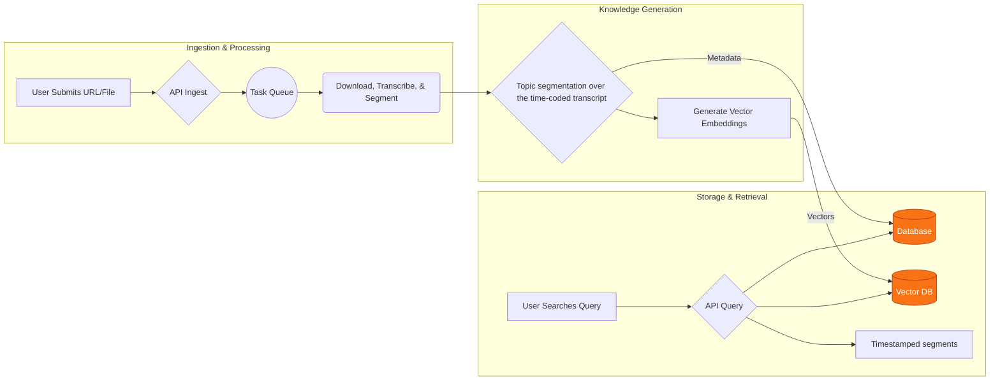

# Citeio


**Media ingest → time-coded transcript → topic segmentation → semantic search that returns timestamped segments tied to the original content.**

> **Status:** Revival / reorganization. Core application code is private. The domain citeio.com is no longer controlled by this project. This public repository is a showcase of the architecture and retrieval approach.

A search hit is a piece of the source you can inspect: topic, transcript excerpt, start and end times, and the media that excerpt came from.

### Example

Query: `when did they discuss market strategy?`

```json
{
  "media_id": "yt_8f2a1c",
  "title": "Q3 planning interview",
  "topic": "Go-to-market sequencing",
  "start": "00:14:22",
  "end": "00:16:05",
  "text": "We held the enterprise tier until the self-serve loop was measurable."
}
```

Illustrative shape. `start` and `end` are positions in the original media. `text` is the transcript span for that segment. `media_id` identifies the source.

-----

## The Problem: Lost Knowledge in Long-Form Content

Valuable passages sit inside hours of podcasts, lectures, and interviews. Finding a specific topic means scrubbing the timeline by hand. The recording holds the knowledge, and the useful moment is a span of that recording.

## The Solution: A Semantic Index Anchored to the Recording

Citeio builds that index from the time-coded transcript. It segments the transcript into topics, embeds those segments, and returns the passages that match a query. Each passage stays tied to timestamps in the original file, so the result can be checked against the source.

-----

## ► Core Features

* **🎙️ Automated Ingestion & Transcription:**

  * Ingest media from sources such as YouTube or a direct file.
  * Standardize content into a consistent audio format for analysis.
  * Produce a precise, time-coded transcript for every piece of media.

* **🧠 AI-Powered Content Intelligence:**

  * Identify and segment distinct topics inside a single file.
  * Store each topic as a time range plus the transcript span it covers.
  * Attach a short label to that span so the segment can be scanned and opened in the source.

* **🔍 Powerful Semantic Search:**

  * Query the library in natural language (for example, "when did they discuss market strategy?").
  * Match concepts and ideas, and return the timestamped segment.
  * Each hit includes the topic, the transcript excerpt, start and end times, and the source media.

* **⚙️ Developer-First RESTful API:**

  * Expose ingest, transcripts, topic segments, and search.
  * Responses use the same inspectable objects: time-coded transcript lines and timestamped segments tied to the original media.

-----

## ► How It Works: The Analysis Pipeline

The platform uses an automated pipeline that keeps every later step attached to the ingested media.



Search reads metadata and vectors together and returns segments with `start`, `end`, transcript text, topic, and media id.

-----

## ► Usage & Pricing Plans

The table is the product's credit model, kept here as part of the architecture showcase. Purchases sit outside this repository. The domain citeio.com is no longer controlled by this project.

| Plan       | Price | Analysis Credits   | Clips per Search | Credit Expiration |
| :--------- | :---: | :----------------: | :--------------: | :---------------: |
| **Free** | **$0** | 5                  | Up to 10         | 3 Days            |
| **Starter**| **$3** | 10                 | Up to 100        | 15 Days           |
| **Creative**| **$21** | 84                 | Up to 100        | 30 Days           |
| **Pro** | **$84** | 420                | Up to 100        | 60 Days           |

### Plan Details

* **Free:** 5 credits for a first analysis. Includes the account's transcript library, folders, and semantic search that returns up to 10 clips. Credits expire in 3 days.

* **Starter ($0.33 per credit):** 10 credits. Transcript library, folders, and up to 100 clips per search. Credits expire in 15 days.

* **Creative ($0.25 per credit):** 84 credits. Same library and search limits, sized for longer projects. Credits expire in 30 days.

* **Pro ($0.20 per credit):** 420 credits. Same library and search limits, sized for heavier research. Credits expire in 60 days.

### Important Notes on Plans

A repeat purchase of the same plan, while one is active, is queued. Credits from the queued plan start once the current plan's credits are depleted or expire. Different plan types can be active at the same time. Free-tier credits are for new accounts.

-----

## ► Tech Stack

This project is built on a modern, robust, and scalable technology stack, leveraging Google's state-of-the-art AI infrastructure.

| Category   | Technologies                                               |
| :--------- | :--------------------------------------------------------- |
| **Frontend** | `Next.js`, `React`, `TypeScript`, `Tailwind CSS`           |
| **Backend** | `Python`, `Flask`, `Celery`, `Redis`                     |
| **AI / ML** | `Google Gemini`, `Google Text Embedding v4`                |
| **Database** | `MongoDB` (for metadata), `MongoDB Vector Search` (for vectors)      |
| **Deployment** | `Vercel` (Frontend), `Cloudflare Tunnel` (API), `Mac Mini` (Self-Hosted), `DigitalOcean` (BTCPay Server), `Docker` |

-----

## ► Project Status & Roadmap

**Current status:** Revival / reorganization. Core application code is private. The domain citeio.com is no longer controlled by this project. This public repository is a showcase of the architecture and retrieval approach.

Application source lives in the private repositories [`citeio-web`](https://github.com/IndigoNakamoto/citeio-web) (Next.js) and [`citeio-api`](https://github.com/IndigoNakamoto/citeio-api) (Flask + Celery).

**What's next:** Expand data sources, and keep every new retrieval path anchored to timestamped source segments.

* **🤖 Search & Interaction:**

  * **Chat with Media:** Ask follow-up questions and receive answers that cite the timestamped segments they use.
  * **Hybrid Search & Reranking:** Combine keyword and semantic matching, then rerank, and still return timestamped segments.
  * **Cited Context:** A query can return a short note built from the matched segments, with each claim tied to a start and end time in the source.

* **🌐 Expanding Data Sources:**

  * **X (Twitter) Spaces:** Ingest and analyze live and recorded audio conversations from X Spaces.
  * **Vimeo Integration:** Broaden support for professional video content hosted on Vimeo.
  * **Direct User Uploads:** Allow users to securely upload their own private audio and video files for analysis.

## ► Proprietary Source Code

Citeio is a commercial product. Application source lives in the private repositories [`citeio-web`](https://github.com/IndigoNakamoto/citeio-web) and [`citeio-api`](https://github.com/IndigoNakamoto/citeio-api). This public repository showcases the architecture and the retrieval approach: timestamped segments tied to the original content.

## ► Contact & Inquiries

For business inquiries, enterprise licensing, or a private walkthrough of the architecture, reach out.

**Indigo Nakamoto** — **[x.com/indigo\_nakamoto](https://x.com/indigo_nakamoto)**
