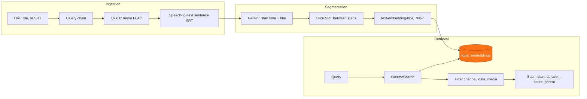

# Citeio


Research note on source-anchored retrieval for long-form audio and video.

**Media ingest → time-coded transcript → topic segmentation → semantic search that returns timestamped segments tied to the original content.**

> **Status:** Revival / reorganization. Core application code is private. The domain citeio.com is no longer controlled by this project. This public repository is a showcase of the architecture and retrieval approach.

The unit of retrieval is a topic span. A model names where a topic starts. The text of the span is copied from the time-coded transcript.

-----

## Method

1. **Audio to a sentence SRT.** ffmpeg converts the file to mono 16 kHz FLAC. Google Speech-to-Text (`latest_long`, enhanced, word time offsets, `en-US`) writes the transcript. A cue closes when a word ends in a period. An uploaded `.srt` skips this step and enters the same chain.

2. **Boundaries, then a deterministic slice.** Gemini (`gemini-2.5-pro-preview-03-25`) returns only `{ "time": "HH:MM:SS", "topic": "..." }`, in order. `slice_topics` assigns each SRT cue from that start until the next topic's start. The last topic runs to the end of the file. The stored `topic_transcript` is those cue texts joined. Transcripts longer than 4 hours are extracted in 10-hour windows, merged by start time, then sliced the same way.

3. **Labels sit on the span.** A file-level summary uses `gemini-2.5-flash-preview-04-17`. Each topic label uses `gemini-2.0-flash` over that topic's sliced transcript. The span remains the SRT text.

4. **One embedding per topic.** Default model `text-embedding-004`, 768 dimensions, `task_type=RETRIEVAL_DOCUMENT`. The embedded string is topic title, topic summary, and sliced transcript. If that payload is too large, the service embeds the title and summary. A topic is skipped when that media id and timestamp already have a vector. Queries are embedded with `RETRIEVAL_QUERY`.

5. **Vector search, then filters.** MongoDB `$vectorSearch` runs on `topic_embeddings.topic_embedding`. `numCandidates` defaults to 10 × (offset + page size). The score is `vectorSearchScore`. Channel handle, published-at range, and parent media id are applied after the vector stage. `topic_duration` is computed at read time: the next topic's start minus this start, or the media duration minus this start for the last topic.

Celery runs the chain as transcribe → file summary → topic list → topic embeddings. Each stage records `pending`, `running`, `completed`, or `failed` on the media document. Topic extraction retries 3 times inside a 300-second soft limit. An embedding pass can finish as `partial_failure` when some topics are stored and others are not.

-----

## Result shape

`GET /api/semantic_search_topics` returns a list of topic documents. Keys below are the ones the service projects. Values are illustrative.

Query: `when did they discuss market strategy?`

```json
{
  "topic_name": "Go-to-market sequencing",
  "topic_timestamp": "00:14:22",
  "topic_timestamp_seconds": 862,
  "topic_duration": 103,
  "topic_transcript": "…SRT cues from 00:14:22 until the next topic…",
  "topic_summary": "…label written for that span…",
  "score": 0.86,
  "parent_media_id": "…",
  "title": "Q3 planning interview",
  "youtube_id": "…",
  "youtube_url": "…",
  "channel_name": "…",
  "channel_handle": "@channel",
  "published_at": "…"
}
```

The web client opens the source at `topic_timestamp_seconds` (`&t=` on YouTube, `#t=` on the source page). The search route requests `offset=0` and caps the page at 10 hits, or 100 when the account has an active plan.

A second endpoint, `GET /api/search`, matches titles, summaries, and topic names with a case-insensitive regular expression and returns media records. Semantic search is the path that returns transcript spans.

-----

## Pipeline



An uploaded SRT enters at segmentation. Filters run after nearest-neighbor search, so a selective filter can shorten a page.

-----

## Stack

| Category | Technologies |
| :--------- | :--------------------------------------------------------- |
| **Frontend** | `Next.js`, `React`, `TypeScript`, `Tailwind CSS` |
| **Backend** | `Python`, `Flask`, `Celery`, `Redis` |
| **Speech** | Google Speech-to-Text `latest_long`, word time offsets, sentence SRT |
| **Boundaries** | `gemini-2.5-pro-preview-03-25` emits `{time, topic}` |
| **Labels** | `gemini-2.5-flash-preview-04-17` (file), `gemini-2.0-flash` (topic) |
| **Embeddings** | `text-embedding-004`, 768-d, `RETRIEVAL_DOCUMENT` / `RETRIEVAL_QUERY` |
| **Database** | `MongoDB` for media metadata, `MongoDB Vector Search` on `topic_embeddings` |
| **Deployment** | `Vercel` (frontend), `Cloudflare Tunnel` (API), `Mac Mini` (self-hosted workers), `DigitalOcean` (BTCPay Server), `Docker` |

-----

## Open questions

These are the next experiments on the same hit object. They are not in the running path.

* Combine the regex index and the vector index, then rerank, and still return the sliced span.
* Move channel, date, and media filters into the `$vectorSearch` pre-filter so the candidate pool is the filtered set.
* Keep the transcript inside the embedding when the payload exceeds the size limit. The current fallback embeds the title and summary.
* Ask a follow-up question and answer it by citing `topic_timestamp`, `topic_duration`, and `topic_transcript`.

-----

## Where the code lives

Application source is private: [`citeio-web`](https://github.com/IndigoNakamoto/citeio-web) (Next.js) and [`citeio-api`](https://github.com/IndigoNakamoto/citeio-api) (Flask + Celery). This repository is the public research note.

**Indigo Nakamoto** — **[x.com/indigo\_nakamoto](https://x.com/indigo_nakamoto)**
